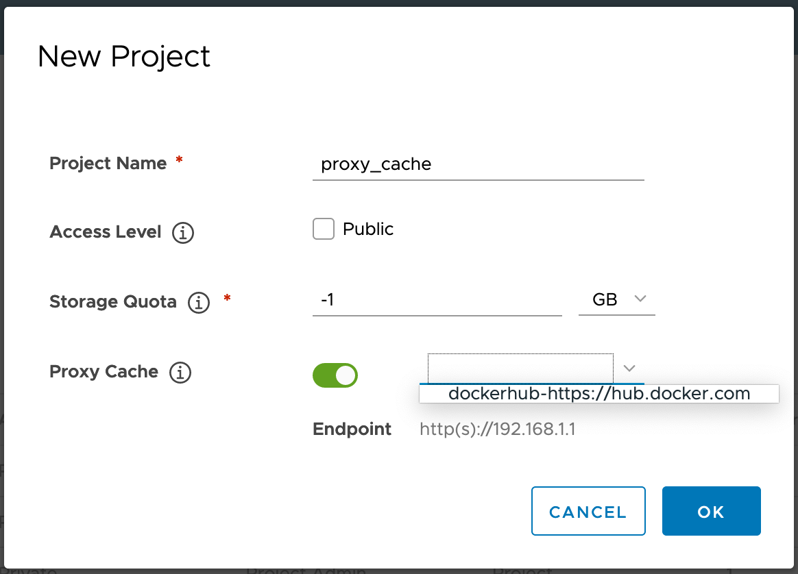

Proxy cache allows you to use Harbor to proxy and cache images from a target public or private registry. As of Harbor v2.1.1, the proxy cache feature was updated to align with [Docker Hub's rate limit policy](https://www.docker.com/blog/scaling-docker-to-serve-millions-more-developers-network-egress/). If you plan to use proxy cache with your Harbor instance, it is strongly recommended that you use v2.1.1 or later to avoid being rate limited.

You can use a proxy cache to pull images from a target Harbor or non-Harbor registry in an environment with limited or no access to the internet. You can also use a proxy cache to limit the amount of requests made to a public registry, avoiding consuming too much bandwidth or being throttled by the registry server.


Harbor supports proxy caching for the following registries:
   - Harbor
   - Docker Hub
   - Docker registry
   - AWS Elastic Container Registry
   - Azure Container Registry
   - Google Container Registry
   - Quay
   - GitHub Container Registry
   - JFrog Artifactory Registry



A Harbor system administrator configures a proxy cache by creating a proxy cache project, which connects to a target registry using a registry endpoint you have configured. A proxy cache project works similarly to a normal Harbor project, except that you are not able to push images to a proxy cache project.

To use a Harbor proxy cache, configure your docker pull commands and pod manifests to pull images from the proxy cache project instead of the target registry.

## How Harbor proxy cache works

When a pull request comes to a proxy cache project, if the image is not cached, Harbor pulls the image from the target registry and serves the pull command as if it is a local image from the proxy cache project. The proxy cache project then caches the image for a future request.

The next time a user requests that image, Harbor checks the image's latest manifest in the target registry and serves the image based on the following scenarios:

* If the image has not been updated in the target registry, the cached image is served from the proxy cache project.
* If the image has been updated in the target registry, the new image is pulled from the target registry, then served and cached in the proxy cache project.
* If the target registry is not reachable, the proxy cache project serves the cached image.
* If the image is no longer in the target registry, no image is served, unless the **Serve stale content locally** setting of the project is enabled. See [Proxy Cache Settings](#proxy-cache-settings).

As of Harbor v2.1.1, Harbor proxy cache fires a HEAD request to determine whether any layer of a cached image has been updated in the Docker Hub registry. Using this method to check the target registry will not trigger the [Docker Hub rate limiter](https://www.docker.com/blog/scaling-docker-to-serve-millions-more-developers-network-egress/). If any image layer was updated, the proxy cache will pull the new image, which will count towards the Docker Hub rate limiter.


Proxy cache follows upstream registry authentication challenges (for example, `WWW-Authenticate: Bearer realm="..."`) to obtain tokens.
The token service endpoint can be different from the registry host (for example, Docker Hub).
Only configure proxy cache endpoints that are within your trust boundary, and use least-privilege credentials for the upstream access account.


## Create Proxy Cache Project

To set up a proxy cache, a Harbor system administrators can create a proxy cache project that connects to a target registry using a registry endpoint.

A proxy cache project is able to use the same features available to a normal Harbor project, except that you are not able to push images to a proxy cache project. For more information on projects, see the [Working with Projects](../../working-with-projects/) documentation.

1. Before creating a proxy cache project, create a registry endpoint for the proxy cache project to use. See how to [create a registry endpoint](../configuring-replication/create-replication-endpoints.md).

    Proxy cache projects can pull every image from the target registry that the access account you configure in the registry endpoint has access to. This means that Harbor users with access to the proxy cache project are able to pull any image available to the access account in the target repository.
    

1. On the Projects page, click **New Project** and configure the new project information. See the [Create Projects](../../working-with-projects/create-projects/) documentation for more details.

1. Click the **Proxy Cache** slider and then select your registry endpoint from the drop-down that appears.

    

1. Optionally, change the proxy cache settings that appear below the endpoint. See [Proxy Cache Settings](#proxy-cache-settings).

1. Click **OK**.

You can view all available proxy cache projects from the Projects page.

Harbor creates a tag retention policy for each new proxy cache project that retains the artifacts pulled within the number of days set in **Retention period (days)**, 7 days by default. See more about [Tag Retention Policies](../../working-with-projects/working-with-images/create-tag-retention-rules.md).

To start using the proxy cache, configure your docker pull commands or pod manifests to reference the proxy cache project by adding `<harbor_servername>/<proxy_project_name>/` as a prefix to the image tag. For example:

```bash
> docker pull <harbor_server_name>/<proxy_project_name>/goharbor/harbor-core:dev
```

## Proxy Cache Settings

The following settings are available when you create a proxy cache project. After the project is created, a Harbor system administrator can change all of them except **Endpoint** and **Retention period (days)** in the **Configuration** tab of the project.


Setting | Description
:-------|:-----------
**Endpoint** | The registry endpoint that the project proxies and caches artifacts from. You cannot change the endpoint after the project is created.
**Retention period (days)** | The number of days used by the tag retention policy that Harbor creates for the project. The policy runs every day and retains the artifacts that were pulled within this number of days in all repositories. Enter a whole number from `0` to `18250`. With `0`, all cached artifacts can be deleted when the policy runs. The default is `7`. To change the policy after the project is created, go to the **Policy** tab of the project and edit the rule under **Tag Retention**.
**Bandwidth** | The maximum network bandwidth that Harbor uses to pull artifacts from the upstream registry, in Kbps or Mbps. Enter `-1` for unlimited bandwidth. The default is `-1`.
**Max connection to upstream registry** | The maximum number of concurrent requests that Harbor forwards to the upstream registry for the project. Requests that Harbor serves from the cache are not counted. When a request would exceed the limit, Harbor rejects it with the HTTP status code `429 Too Many Requests` and the client has to retry it. Enter `-1` for no limit. The default is `-1`.
**Repository filter** | An optional pattern that restricts the repositories that users can pull through the project. See [Restrict the Repositories of a Proxy Cache Project](#restrict-the-repositories-of-a-proxy-cache-project).
**Serve stale content locally** | If a cached artifact is no longer found in the upstream registry, for example because its tag was deleted there, Harbor serves the cached artifact instead of returning a `not found` error. This can lead to Harbor serving artifacts that were removed from the upstream registry. Disabled by default.
**Enable proxy for referrer API** | Forwards [OCI referrers API](https://github.com/opencontainers/distribution-spec/blob/main/spec.md#listing-referrers) requests for the project to the upstream registry. See [Proxy the Referrers API](#proxy-the-referrers-api). Disabled by default.


By default, Harbor applies the **Max connection to upstream registry** limit separately to each repository and digest that is fetched from the upstream registry. To apply the limit to all the upstream requests of a project together, set the `UPSTREAM_REGISTRY_LIMIT_ON_PROJECT` environment variable of the Harbor core service to `true`.

### Restrict the Repositories of a Proxy Cache Project

By default, users with access to a proxy cache project can pull any repository that the access account of the registry endpoint can read. To allow only some repositories, enter a pattern in **Repository filter** and select how Harbor matches it:

* **Doublestar** (default): A glob pattern. `*` matches any sequence of characters within one path segment, `**` matches across path segments, and `{a,b}` matches either of the comma-separated alternatives. For example, `library/**` allows all repositories under `library`, and `library/{nginx,alpine}` allows only `library/nginx` and `library/alpine`.
* **Regex**: A regular expression. The expression must match the whole repository name. For example, `library/.*` allows all repositories under `library`.

Harbor matches the pattern against the repository name in the upstream registry, without the name of the proxy cache project. For example, when a user pulls `<harbor_server_name>/<proxy_project_name>/library/nginx:latest`, Harbor matches `library/nginx`. For Docker Hub endpoints, Harbor adds the `library/` prefix to repository names that have no namespace before matching, so a pull of `<harbor_server_name>/<proxy_project_name>/nginx:latest` is also matched as `library/nginx`.

If a repository does not match the filter, Harbor rejects pulls of the repository with a `not found` error, even if the repository was cached before the filter was set. If **Enable proxy for referrer API** is enabled, Harbor also returns `not found` for referrers requests of the repository. Leave the filter empty to allow all repositories.

### Proxy the Referrers API

Clients such as ORAS and Notation use the OCI referrers API to discover the signatures, SBOMs, and other artifacts that refer to an image. By default, a proxy cache project only returns the referrers that are stored in Harbor. When you enable **Enable proxy for referrer API**, Harbor handles referrers requests for the project as follows:

* Harbor forwards the request to the upstream registry, including the paging and `artifactType` filter parameters, and returns the referrers that the upstream registry lists. Referrers that Harbor created itself for the artifact, such as SBOMs that Harbor generated, are added to the last page of the results.
* Harbor caches each response for up to 7 days. If the registry endpoint is unhealthy, Harbor serves the cached response.
* If the upstream registry returns `not found`, Harbor returns `not found`. If the request to the upstream registry fails for any other reason, Harbor falls back to the referrers that are stored in Harbor.

## Monitor Proxy Cache Projects

If you enable [metrics](../metrics/) in your Harbor instance, Harbor core exposes two counters for each proxy cache project:

* `harbor_core_http_registry_proxy_requests_total` counts the manifest and blob requests that the project receives.
* `harbor_core_http_registry_proxy_upstream_requests_total` counts the manifest and blob requests that Harbor forwards to the upstream registry because the content is not in the cache or is out of date.

Both counters have the labels `project` and `method`. The ratio between the two counters is the cache miss rate of the project. For example, the following Prometheus query returns the cache hit rate of each proxy cache project over the last hour:

```text
1 - sum by (project) (rate(harbor_core_http_registry_proxy_upstream_requests_total[1h]))
  / sum by (project) (rate(harbor_core_http_registry_proxy_requests_total[1h]))
```
